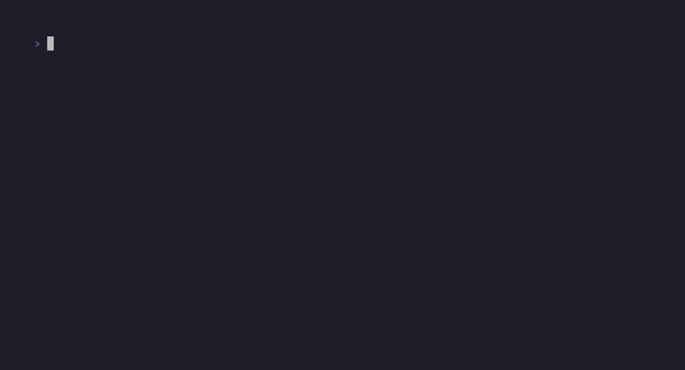

<div align="center">

# CCCandybar

**Powerline statusline for Claude Code — daemon-backed, config-driven, zero-config-file required.**


[](https://www.npmjs.com/package/@promptctl/cc-candybar)
[](https://www.npmjs.com/package/@promptctl/cc-candybar)



</div>

**[Try the live bar in your browser →](https://promptctl.github.io/cc-candybar/main/)** The real daemon, compiled for the page, replays a few turns of a Claude Code session; every click in the bar is real.

## What it is

CCCandybar is a statusline renderer for [Claude Code](https://docs.anthropic.com/en/docs/claude-code). It shows session cost, context usage, git status, model info, rate-limit utilization, and more, configured through a JSON5 DSL with hot-reloading.

A background daemon caches git state, usage data, and per-session values across concurrent Claude Code sessions. The renderer connects to the daemon over a Unix socket, so every invocation is fast (~50ms budget) and stateful.

## Quick start

```bash
pnpm dlx @promptctl/cc-candybar@latest install
```

npm is the only install channel: the GitHub releases are tags plus a changelog with no downloadable assets, and installing from a GitHub tag does not work (the built `dist/` is not committed).

pnpm 11 delays freshly published packages (`minimumReleaseAge`), so on or near a release day `@latest` can silently resolve to an older version. `install` compares what it staged against the registry and warns when it is behind; to get a specific release immediately, name it: `pnpm dlx @promptctl/cc-candybar@<version> install`.

That single command (re-run it any time to update to the latest release):

1. Stages the runtime at a stable path independent of any package-manager cache — `~/Library/Application Support/CCCandybar/` on macOS, `$XDG_DATA_HOME/cc-candybar/` on Linux — as `bin/cc-candybar` (the prebuilt native render binary for your platform, or a node entry where none exists) beside `dist/index.mjs` (the daemon + CLI bundle).
2. On macOS, builds `~/Applications/CCCandybarURLHandler.app` and registers the `cc-candybar://` URL scheme with Launch Services.
3. Writes the staged `bin/cc-candybar` path as the statusline command into `~/.claude/settings.json` (skipped with a notice if you've customized the command; `--force` overwrites).

Restart Claude Code. The statusline appears with the bundled default layout — an identity row (host, directory, gitaculous) over a status row (model, context, autocompact, cacheTimer, block, weekly, activity). On macOS, Cmd-clicking clickable cells fires `cc-candybar://` URL verbs that the daemon dispatches (via the URL handler registered in step 2).

**Over ssh.** A click opens on the Mac the terminal is on, and the bar was drawn by the daemon on the machine you ssh'd into. On that machine run `cc-candybar ssh-config ALIAS`, where ALIAS is the `Host` your Mac's ssh config reaches it by, and add the lines it prints to the Mac's `~/.ssh/config` (and re-run `cc-candybar install` on the Mac, which makes the directory the forwards land in). Clicks reach that machine's daemon while an ssh connection to it is open, and a click on a bar whose connection is closed says that no forward for its key is open or that it does not answer. Copy links use the Mac’s clipboard. Open-in-editor links open the remote path in VS Code on the Mac through Remote - SSH. If you already have a forward whose socket name contains only the key ID, regenerate its stanza with the command above and reconnect so the editor can use the host alias.

While Candybar starts, the statusline shows **Candybar · waiting for daemon…**. If a render times out, the bar shows a `tail` command you can run in your terminal to read the daemon log. The command works even while the daemon is unresponsive. The next successful render replaces the message.

## Customization

Config layers load in this order, with each layer overriding the ones before it.

1. The bundled defaults.
2. Your user config at `$XDG_CONFIG_HOME/cc-candybar/config.json5` (defaults to `~/.config/cc-candybar/config.json5`).
3. `<project>/.cc-candybar.json5`.
4. `<project>/.cc-candybar.local.json5`, for personal project settings.

`--config PATH` selects a different user config. Approved project and local settings and repository plugins still load. `CC_CANDYBAR_CONFIG` supplies the user path when neither config flag is set. Relative paths are resolved from the statusline client's working directory, and `~` expands to the client's home. If the named file is missing, the bar shows a warning and watches for the file to appear.

`--config-only PATH` loads the named file over the bundled defaults. It skips project config, auto-discovered repository plugins, and project trust prompts. Installed plugins and definitions explicitly listed in the named file remain available.

The bar writes to the layer you pick when saving. You can save to your user file, the shared project file, or the local project file. Candybar adds the local file to the repository's `info/exclude`. If a higher layer sets the same value, the bar names that file when it refuses the write. When a config error prevents writing, the built-in Save controls disappear until the config loads again. Your draft stays available.

Candybar asks once per project before loading its shared config, local config, or plugins in `.cc-candybar/plugins/`. Until you choose Approve or Decline, the bar uses your own config. Your choice covers later edits and additions, every renderer, daemon restarts, and linked Git worktrees. A saved project decision takes precedence over an older answer for one of its worktrees. A checkout with a separate Git directory, such as a submodule, keeps its own decision.

To ask again, remove the project's entry from `$XDG_STATE_HOME/cc-candybar/repo-configs/repo-configs.json`. The default path is `~/.local/state/cc-candybar/repo-configs/repo-configs.json`.

JSON is a strict subset of JSON5, so the same parser handles both — `.json5` is the documented format (supports inline comments, trailing commas, unquoted keys), `.json` is the legacy/compat extension. When both exist at the same location, `.json5` wins and the bar shows a persistent warning so you can remove the shadowed duplicate.

The file **merges onto the bundled default**, so it declares only what differs. `globals` merge per field; the named sections (`variables`, `segments`, `actions`, `helpers`, …) merge by name, your entry winning; `root` merges per named row (`identity` and `status` in the bundled default; a whole tree at `root` replaces every row). The bundled default is `src/config/default-dsl-config.ts`, and fuller starting points live under `examples/`.

The running bar shows config and source diagnostics under `⚠`. From a source checkout, run `./plugin/bin/preview.sh --config-only=/path/to/config.json5` to draw the named file in a sample session. Use a real Claude Code session to exercise its environment, sources and clicks. `cc-candybar schema` prints the config schema for editor tooling.

<!-- The check:pass fence below is exercised by test/doc-snippets.test.ts. -->

```json5 check:pass
// A theme, one new segment, and the row it joins. Everything else — the
// identity row, every other segment and variable — is inherited.
{
  globals: { palette: 'catppuccin-mocha' },
  variables: {
    clock: { kind: 'time', layout: '15:04' }, // Go reference-time layout, re-read every second
  },
  segments: {
    clock: { template: '{{ .clock }}' },
  },
  root: { rows: { status: { h: ['model', 'context', 'clock'] } } },
}
```

Saving the file triggers a hot-reload of every active session.

## Record and replay a renderer

With the daemon running, start a capture, reproduce the bar behavior, and stop the capture to save it.

```sh
cc-candybar record start ./bar.jsonl
cc-candybar record stop
cc-candybar replay ./bar.jsonl
```

Both record commands accept `--renderer NAME`. The default is `CC_CANDYBAR_NAME`, then `main`. Starting replaces a running worker between turns. Its menu history and unsaved edit drafts reset. Saved state carries over, and the host and other renderers keep running. An unbound name starts recording when that renderer first starts. Choose a new file. The host publishes it when you stop recording or when the daemon shuts down normally with a complete capture.

Replay runs offline and verifies the whole recording before reporting success. Use the `cc-candybar` build for the renderer you recorded. Different builds can draw different output even with the same private wire version. Add `--frames` to print JSON lines containing `session`, `surface`, and `frame` on stdout. The summary goes to stderr in this mode. If frame output exceeds 32 MiB, replay reports the limit and emits no frames. Summary mode verifies incrementally without retaining frames.

Treat recordings as private. They include config snapshots, project paths and displayed data. The host refuses a capture that contains a configured `env` value, a run action’s environment overlay, or output from a command given session environment values. This includes a shell source given only `PATH` and an action that returns child stderr. The live bar keeps working. `record stop` gives the reason for a refusal. An upgrade closes the retired layout tab and toggles submenu in saved sessions, so those selections can no longer block a capture. If the reason is unrecognized saved state, use a fresh renderer profile. If it is config syntax, fix the config before recording again.

## Architecture

```
┌─────────────┐   Unix socket   ┌──────────────────┐
│ Claude Code │ ──────────────► │ cc-candybar daemon│
│  (hook)     │   render req    │                  │
│             │ ◄────────────── │  git cache       │
└─────────────┘   ANSI output   │  usage cache     │
                                │  session state   │
                                │  render cache    │
                                └──────────────────┘
```

- **Daemon** (`src/daemon/`) — long-lived background process. One per user. Caches git state via filesystem watchers, usage data, and per-session key/value state. Runs until it exits on a memory backstop — on what the platform charges the process: `phys_footprint` on macOS, RSS on Linux (default 1024 MB via `CC_CANDYBAR_RSS_LIMIT_MB`; the V8 heap cap the spawner passes is twice that, a margin wide enough that the graceful backstop fires first under any growth its 60 s poll can see) or the host restarts; there is no idle or age timeout.
- **Client** (`rust-client/src/main.rs`) — the Rust binary installed as `bin/cc-candybar`, and the only thing on the per-render path: it connects to the daemon, sends the hook JSON, and prints the ANSI response. A statusline tick starts a missing daemon and can display on the next refresh. Both the installed native client and the Node fallback recover this way. Companion commands such as `frames`, `follow`, and the tmux bar pane connect to the same daemon. Every subcommand such as `install` and `daemon` execs the Node bundle at `dist/index.mjs`, which carries a socket relay of its own (`src/daemon/client.ts`) as the fallback when no native binary is staged.
- **Renderer** (`src/dsl/render.ts`) — `drawDsl` is the single render path; the daemon and the rendering tests call it. It walks the config's layout tree, evaluates each segment's templates against the daemon's payload, and hands the styled cells to `src/render/` (strip and joiner selection, pickers and menus, the diagnostics viewer). The payload's data comes from the providers in `src/segments/` — git, session, context, metrics, tmux, pricing.
- **Themes** (`src/themes/`) — palette construction plus name policy (which theme, style, variation, endcaps and colour depth names resolve to what). The colour arithmetic itself — blending, contrast, OKLCH transposition — lives in the separate `rich-js` package; this repo does none of it.

## Segments

These are the segment names `DEFAULT_DSL_CONFIG` declares, each available to a user's `root` whether or not the default bar places it.

| Segment | Shows | Visible |
|---------|-------|---------|
| `directory` | the cwd, abbreviated fish-style (`~/c/cc-candybar`) | always |
| `model` | `✱` and the model's display name | always |
| `sessionId` | `⌗` and the first 8 characters of the session id | always |
| `version` | `◈ v` and the Claude Code version | always |
| `tmux` | `tmux:` and the tmux session name | inside tmux |
| `host` | `⇄ user@host` | over SSH |
| `gitaculous` | the git state, collapsed to `⎇` branch, ahead/behind and `S`/`U`/`?`/`!` flags; the `▸` at its right edge expands it to `(git)`, repo, operation, sha, flags, branch, upstream ±, stashes and time since the last commit, and `◂` collapses it again (per session). Each form and piece is overridable ([docs/segment-authoring.md](docs/segment-authoring.md#reshaping-a-bundled-segment-git)) | in a repo |
| `gitPr` | `⇆ #N` linked to the pull request, or `⚠ PR` when the forge lookup failed | when a PR or a lookup error is known |
| `toolbar` | click affordances — copy the session id, open the project dir, the transcript and the repo page (also inside the settings menu) | always |
| `commands` | type `/compact`, `/model` or `/clear` into this session; `/clear` asks for a second click (also inside the settings menu) | inside tmux (not placed by default) |
| `session` | `§` this session's cost and tokens, plus budget status | always |
| `today` | `☉` today's cost and tokens across sessions, plus budget status | always |
| `block` | `◱` the 5-hour rate-limit window's utilization | while that window is active |
| `weekly` | `◑` the 7-day rolling rate limit's utilization | while that window is active |
| `burnrate` | `⚡` cost per hour, then ETA to the 5-hour and weekly limits | while either window is active |
| `speed` | `⇅` output, input and total tokens per second | once the session has tokens |
| `tokenSparkline` | `⚡` a sparkline over the last 24 speed samples | once speed samples exist |
| `cacheTimer` | `◴` minutes until the prompt cache expires, or `cold` | while a cache expiry is known |
| `context` | `◔` context tokens used and the percentage left | when context tokens are known |
| `autocompact` | `⇲` Claude Code's auto-compact window — `auto`, or the tokens `/autocompact` last set; `−`/`+` move it by 100K up to the model's context window, `↺` returns it to `auto`. Each click types `/autocompact` into the session, so the controls show only inside tmux. Placed beside `context` | always |
| `metrics` | `Δ` last response time, `⧖` response time, `⧗` session duration, `◆` message count, lines changed | when any of those exist |
| `activity` | `⌘` the slash command that opened the turn, `☐` the in-progress todo with its position, `⟳` tools in flight and `✓` tools finished this turn | while the session is doing something |

Every bar also carries, right after the settings menu's door, a cell saying how it is redrawn: `≤30 fps` while an animation lane draws it where you can see it, ` ≤1 fps` while that lane's bar is off screen, and ` polled` when Claude Code reruns the statusline itself. The number is the most frames a second the lane draws; a lane redraws the bar only when it changes, so a still bar is redrawn far less often. It sits wherever the door does, so no layout has to place it, and none can leave it out. On the statusline, which can't see the pointer move or deliver an alt+click, a click-mode toggle sits beside it: `☝` clicks as usual, `⌖` hovers and `⌥` runs each region's alt+click binding. The tmux bar pane delivers those gestures itself, so it shows no toggle there.

The lit ticket a checkout is working on is not bundled: it is a plugin, installed with `cc-candybar plugin install promptctl/links-issue-tracker`, whose one segment (`plugins.lit.ticket`, each of its parts a setting) is in edit mode's add-segment library. It reads the `.lit/statusline.json` lit keeps in each checkout, so no lit process runs for the bar.

Each segment is a DSL declaration with a `template` (text + interpolation + style functions), a `bg`/`fg` palette spec, and optional `when` predicate. Templates compose freely — every formatter in the bundled function library (`formatCost`, `formatTokens`, `formatLongTimeRemaining`, `budgetStatus`, `link`, `urlEncode`, the sprig string/list/dict library, …) is available in every segment.

## Themes

The DSL config picks a base palette via `globals.palette` (e.g. `textual-dark`, `gruvbox`) — or a template evaluated every render, so the theme can follow live data. Each segment may override with its own `palette:` field, and `bg`/`fg` take a palette colour name (`primary`, `surface`, `panel`, `accent`, `foreground`, `warning`, `error`, …) or a computed colour such as `{{ darken (color "primary") 2 }}`; a segment that authors no `bg` wears the theme's decorative tint for its position. Color math runs through OKLCH for perceptual uniformity.

## Installation

Requires Node.js 20.19+ (within the 20.x line) or 22.12+, Claude Code, and Git 2.0+. For best display, install a [Nerd Font](https://www.nerdfonts.com/) so the powerline glyphs render correctly.

### Manual setup

Run the install once to stage the runtime, then point `~/.claude/settings.json` at the staged entry (this is also exactly what `install` writes):

```json
{
  "statusLine": {
    "type": "command",
    "command": "'/Users/you/Library/Application Support/CCCandybar/bin/cc-candybar'"
  }
}
```

### Developing against a checkout

`just deploy` builds `dist/index.mjs` and stages the native binary at `bin/cc-candybar-native` — point your statusline command at that path. On a machine without cargo, `pnpm install && pnpm build` builds only the bundle — point your statusline at the committed `bin/cc-candybar` node entry instead. Either way the bar renders HEAD once the statusline command names this checkout and its bundle is recorded: `just deploy` records it, and on a machine without cargo run `node dist/index.mjs record-host-bundle` after the build. The daemon watches the built bundle and the record, and respawns itself on a rebuild.

`pnpm bar:web` serves the bar at http://127.0.0.1:7317/ in a browser terminal you can click: an isolated daemon (`--config my.json5` starts it from a copy of your config, `--ssh` shows the host segment). `pnpm site:build` builds the GitHub Pages version into `site/dist`, the same page with the daemon running inside it against a simulated machine (`site/`). `pnpm site:dev` serves that page at http://127.0.0.1:8931/ (`--port` picks another) and reloads it whenever the sources or the page change.

### Config file

Customization lives in `.cc-candybar.json5`. See the [Customization](#customization) section above for the resolution order. Saved edits hot-reload — no restart needed.

## Contributing

Contributions welcome. See [CONTRIBUTORS.md](CONTRIBUTORS.md) for people who have contributed outside of GitHub PRs.

## License

[MIT](LICENSE)
